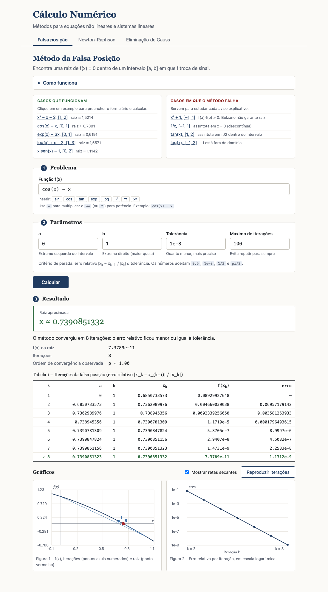
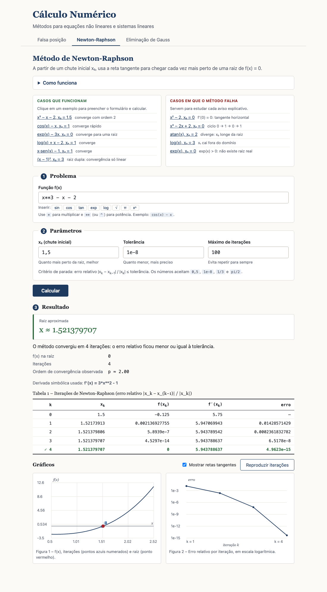
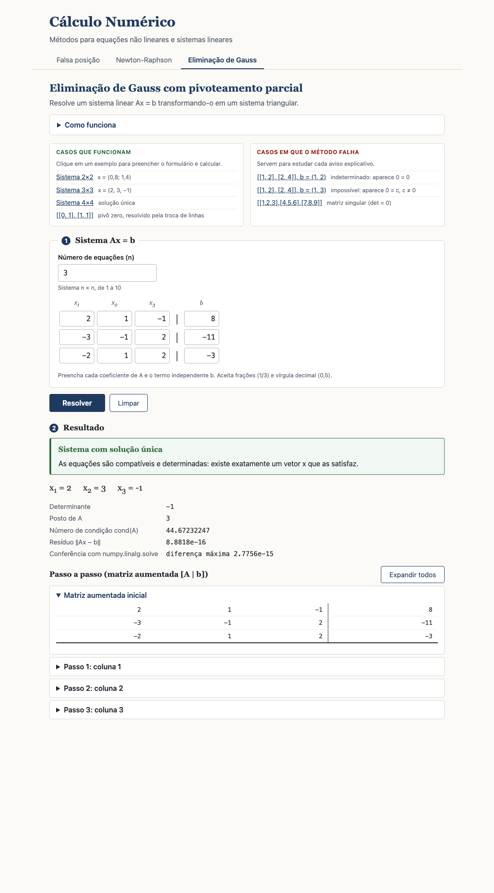
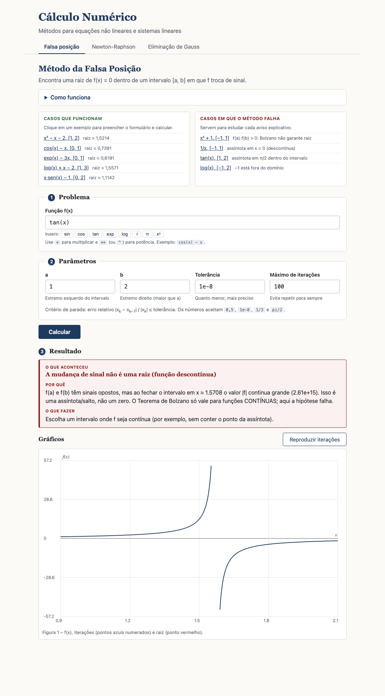

# Cálculo Numérico: Falsa Posição, Newton-Raphson e Eliminação de Gauss

Aplicação web para a disciplina de Cálculo Numérico/Modelagem Computacional. Implementa **três métodos na mão** (sem `scipy.optimize`) e, quando um caso não se encaixa na teoria do método, **explica na tela o que aconteceu, por quê e o que fazer**.

- **Backend:** Python + Flask (`app.py`, `metodos.py`).
- **Front-end:** HTML, CSS e JavaScript puros, sem bibliotecas externas e sem fontes de CDN. Funciona **offline**.
- **Gráficos:** desenhados em `<canvas>`, com a curva de f(x), as iterações, a raiz e o erro por iteração em escala logarítmica.

| Falsa posição | Newton-Raphson | Eliminação de Gauss |
|---|---|---|
|  |  |  |

## Como rodar

Requer Python 3.9 ou superior.

```bash
git clone https://github.com/BernardoCicchelli/Trabalho_ModelagemComp.git
cd Trabalho_ModelagemComp

python3 -m venv .venv
.venv/bin/pip install -r requirements.txt     # Windows: .venv\Scripts\pip install -r requirements.txt
.venv/bin/python app.py                       # Windows: .venv\Scripts\python app.py
```

Abra **http://127.0.0.1:5001** no navegador.

> A porta é a 5001 porque, no macOS, a 5000 costuma estar ocupada pelo AirPlay Receiver. Para mudar, edite a última linha de `app.py`.

## Estrutura

```
app.py              Rotas Flask. Chama os métodos e converte qualquer falha em JSON.
metodos.py          Leitura segura de entradas + falsa posição, Newton e Gauss.
templates/index.html
static/style.css    Estilo acadêmico (com versão para impressão).
static/script.js    Formulários, exemplos, tabelas e gráficos em canvas.
docs/               Capturas de tela usadas neste README.
requirements.txt    flask, sympy, numpy
```

Cada método é **uma função** em `metodos.py`, com comentários em português.

## Critério de erro

Todo o programa usa o **erro relativo**:

```
erro_k = |x_k − x_(k−1)| / |x_k|
```

O método para quando `erro_k ≤ tolerância`. Na primeira iteração não há `x_(k−1)`, então o erro aparece como "—". Se `x_k = 0`, usa-se o erro absoluto para não dividir por zero.

A **ordem de convergência observada** é estimada por

```
p = ln(d_(k+1)/d_k) / ln(d_k/d_(k−1)),   d_k = |x_(k+1) − x_k|
```

## Os métodos

### Falsa posição
Procura uma raiz de `f(x) = 0` em `[a, b]`.

```
x_k = (a·f(b) − b·f(a)) / (f(b) − f(a))
```

A cada passo, o extremo cujo `f` tem o mesmo sinal de `f(x_k)` é substituído por `x_k`. Convergência linear (ordem 1).

**Entradas:** f(x), a, b, tolerância, máximo de iterações.
**Saída:** tabela (k, a, b, x_k, f(x_k), erro), raiz, ordem de convergência e gráficos (opcionalmente com as retas secantes).

### Newton-Raphson
A partir de `x₀`, usa a reta tangente:

```
x_(k+1) = x_k − f(x_k) / f'(x_k)
```

A derivada é calculada **simbolicamente com sympy** e mostrada na tela. Em raiz simples a convergência é quadrática (ordem 2); em raiz múltipla vira linear.

**Entradas:** f(x), x₀, tolerância, máximo de iterações.
**Saída:** tabela (k, x_k, f(x_k), f'(x_k), erro), derivada usada, raiz, ordem de convergência e gráficos (opcionalmente com as retas tangentes). Nas **falhas**, a tabela até o ponto da falha e o gráfico continuam aparecendo.

### Eliminação de Gauss com pivoteamento parcial
Resolve `Ax = b` para matriz quadrada de **ordem n qualquer** (1 a 10 na interface; o servidor aceita até 20).

**Saída:**
- matriz aumentada a cada passo, com pivô, troca de linhas e multiplicadores;
- solução, determinante (produto dos pivôs × (−1)^trocas), posto e número de condição cond(A);
- resíduo ‖Ax − b‖ e conferência com `numpy.linalg.solve`.

## Validações e avisos

Cada caso abaixo gera um aviso na tela com **o que aconteceu**, **por quê** (teorema ou teoria) e **o que fazer**. Nenhum caso derruba o servidor: tudo vira JSON `{ok: false, titulo, explicacao, dica}` e `NaN`/`Infinity` são convertidos em `null`.

**Entradas (todos os métodos)**
- função vazia, constante, com sintaxe inválida ou nome desconhecido;
- tolerância ≤ 0 ou menor que ~1e-15; máximo de iterações ≤ 0 ou não inteiro;
- campos vazios ou não numéricos.

**Falsa posição**

| Caso | Motivo |
|---|---|
| `a ≥ b` | o intervalo não existe |
| `f(a)·f(b) > 0` | Bolzano não garante raiz (pode haver um número par de raízes) |
| função descontínua no intervalo (`1/x` em [−1, 1], `tan(x)` em [1, 2]) | a mudança de sinal vem de uma assíntota, não de uma raiz |
| função fora do domínio (`log(x)` em [−1, 2]) | f não existe no extremo |
| `f(a) = 0` ou `f(b) = 0` | **aviso:** o extremo já é raiz |
| parada atingida com `|f(x)|` ainda grande | **aviso:** extremo "preso" |

**Newton-Raphson**
- `x₀` fora do domínio;
- `f'(x_k) = 0` ou ≈ 0 (tangente horizontal, divisão por zero);
- divergência (`|x_k|` gigante);
- ciclo (`x³ − 2x + 2` com `x₀ = 0` repete 0, 1, 0, 1…);
- `x_k` saiu do domínio (`log(x)` com `x₀ = 3`);
- não convergiu no máximo de iterações (`exp(x)`, que não tem raiz);
- **aviso:** convergência linear (ordem ≈ 1), indicando raiz múltipla.

**Gauss**
- matriz não quadrada, linhas de tamanhos diferentes, `b` incompatível, matriz toda nula;
- pivô ≈ 0 após o pivoteamento: matriz singular, classificada por **Rouché-Capelli**:
  - **impossível**: aparece `0 = c` com `c ≠ 0`, ou seja, posto(A) < posto([A|b]);
  - **indeterminado**: posto(A) = posto([A|b]) < n, com infinitas soluções;
- **aviso:** matriz mal condicionada quando cond(A) > 1e10.

## Exemplos prontos

Cada aba tem dois quadros de exemplos que preenchem o formulário e calculam:

- **Casos que funcionam:** `x³ − x − 2`, `cos(x) − x`, `exp(x) − 3x`, `log(x) + x − 2`, `x·sen(x) − 1`, `(x − 1)²` (raiz dupla), sistemas 2×2, 3×3 e 4×4, e `[[0,1],[1,1]]` (parece pegadinha, mas a troca de linhas resolve).
- **Casos que falham com explicação:** `x² + 1` em [−1, 1], `1/x` em [−1, 1], `tan(x)` em [1, 2], `log(x)` em [−1, 2]; Newton em `x² − 2` com `x₀ = 0`, `x³ − 2x + 2` com `x₀ = 0`, `atan(x)` com `x₀ = 2`, `log(x)` com `x₀ = 3` e `exp(x)`; matrizes `[[1,2],[2,4]]` (indeterminada e impossível) e `[[1,2,3],[4,5,6],[7,8,9]]` (singular).



## Como digitar funções e números

- **Funções:** `x**3 - x - 2`, `cos(x) - x`, `exp(x) - 3*x`, `log(x) + x - 2`, `x*sin(x) - 1`. Potência com `**` ou `^`. Multiplicação implícita (`2x`, `xcos(x)`, `(x+1)(x-1)`) é aceita.
- **Nomes permitidos:** `x`, `sin`/`sen`, `cos`, `tan`, `asin`, `acos`, `atan`, `sinh`, `cosh`, `tanh`, `exp`, `log`/`ln`, `log10`, `sqrt`, `abs`, `pi`, `e`.
- **Campos numéricos:** aceitam vírgula decimal (`0,5`), notação científica (`1e-8`), frações (`1/3`) e expressões como `pi/2`.

Erros de digitação têm mensagem específica: parêntese sem par, função sem argumento (`cos()`), função sem parênteses (`sin x`), operadores seguidos, falta de operador e vírgula dentro da função.

## Segurança

O texto digitado **nunca passa por `eval` livre**. Antes de chegar ao sympy ele é dividido em tokens, e só nomes da lista branca acima são aceitos. Também há limite de 200 caracteres, bloqueio de torres de potência (`9**9**9`) e de expoentes acima de 1000, e o servidor recusa pedidos maiores que 1 MB.

## API

Todas as rotas recebem e devolvem JSON.

| Rota | Corpo |
|---|---|
| `POST /api/falsa-posicao` | `{f, a, b, tol, max_iter}` |
| `POST /api/newton` | `{f, x0, tol, max_iter}` |
| `POST /api/gauss` | `{A, b}` (listas de textos) |

Sucesso: `{ok: true, ...}` (raiz, tabela, ordem, avisos…). Falha: `{ok: false, titulo, explicacao, dica}` e, quando útil, a tabela e a curva para o gráfico.

## Limitações conhecidas

Alguns limites são **escolhas práticas de detecção**, não resultados da teoria:

- função descontínua: considerada quando `|f| > 1e-3` ao fechar o intervalo por bisseção interna;
- extremo "preso": aviso quando `|f(x)| > max(10·tol, 1e-6)` na parada;
- derivada nula no Newton: `|f'| < 1e-14·|f|`; divergência quando `|x_k| > 1e6`;
- pivô nulo no Gauss: abaixo de `ε_máquina · n · max|a_ij|`.

O app não prova que uma função não tem raiz (por exemplo, `exp(x)`): ele só mostra que o método não convergiu e explica as causas possíveis.
